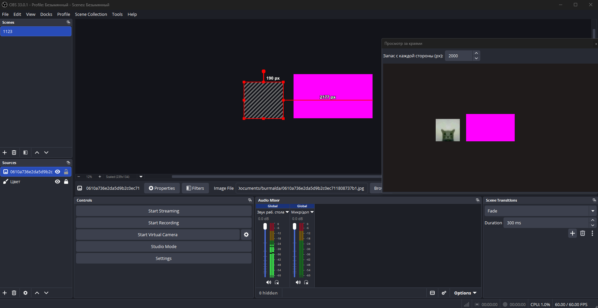

# Overflow View

**Overflow View** is a plugin for OBS Studio that lets you see the parts of your scene that are outside the canvas.

## Preview



## Features

- View the full scene, including elements outside the canvas.
- See the canvas boundaries.
- Access the preview directly from an OBS dock.

## Installation

1. Download the latest `overflow-view.dll` from the [Releases](../../releases) page.
2. Copy the DLL into your OBS Studio plugin directory:
   `obs-studio/obs-plugins/64bit`
3. Restart OBS Studio.
4. Open the **Docks** menu and select **Просмотр за краями**.

## Building from Source

This project uses CMake and Qt 6.

```powershell
cmake -S . -B build_x64 -DENABLE_FRONTEND_API=ON -DENABLE_QT=ON
cmake --build build_x64 --config Release
```

## Compatibility

- Windows
- OBS Studio

## License

See [LICENSE](LICENSE).
